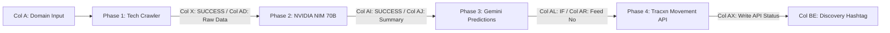
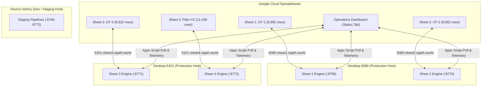

# Discovery Engine — Fleet Operations & Architecture Specification (GEMINI.md)

> **Living Technical Knowledge Base & Fleet Specification for Antigravity & Gemini Agents.**  
> *Maintained for full contextual continuity across new sessions, multi-desktop deployments, and automated cloud sync.*

---

## 1. Executive Summary & Project Mission

**Discovery Engine** is an enterprise-scale, high-throughput asynchronous intelligence pipeline developed for Tracxn. Its mission is to ingest, scrape, summarize, classify, and programmatically route tens of thousands of candidate company domains into Tracxn's platform database.

### Core Processing Waterfall
Every domain progresses through four decoupled, staged event-driven architecture (SEDA) phases:


1. **Phase 1: Tech Crawler (TC)**: High-scale asynchronous browser rendering with Amazon S3 storage and an in-memory `WaterfallScraper` (Playwright / Camoufox / BS4) fallback upon failure or timeout (3-hour rule).
2. **Phase 2: NVIDIA NIM Summarization**: High-speed AI extraction using Llama 3 70B across sharded NVIDIA API keys (35–40 RPM per worker pool).
3. **Phase 3: Gemini AI Predictions**: Gemini 1.5 Flash prediction engine with prompt caching for Industry Funnel (IF) classification and Publishing Feed Number routing.
4. **Phase 4: Tracxn Movement & Hashtagging**: Programmatic movement of validated leads into Central Funnel (CF), Industry Funnel (IF), or Publishing Funnel (PF), and selective tagging of `bu_llm_discovery_processing`.

---

## 2. Hardware Infrastructure & Fleet Topography

The fleet is distributed across three physical machines connected to Google Cloud and Google Spreadsheets via Cloudflare Zero Trust Tunnels:



### Host Specifications & Assignments
| Hostname / Machine | Role | Assigned Sheets | Host Ports | Public Hostnames | Auto-Routing Eligible |
| :--- | :--- | :--- | :--- | :--- | :---: |
| **Desktop-5080** | Production Worker | Sheet 1 (CF-1)<br>Sheet 2 (CF-2) | `8769`<br>`8770` | `https://5080-sheet1.rajath.world`<br>`https://5080-sheet2.rajath.world` | **YES** |
| **Desktop-5321** | Production Worker | Sheet 3 (CF-3)<br>Sheet 4 (Filter-V2) | `8771`<br>`8772` | `https://5321-sheet3.rajath.world`<br>`https://5321-sheet4.rajath.world` | **YES** |
| **Device-Vishnu** | Development / QA | Ad-hoc testing | `8769–8772` | `https://vishnu-*.rajath.world` | **NO** (Manual only) |

### Fleet Concurrency & Balancing Rules
1. **Strict 2-Sheet Limit per Machine**: Neither `Desktop-5080` nor `Desktop-5321` may run more than **2 sheets concurrently**.
2. **Auto-Rerouting Policy**: If a scheduled or manual trigger fires for a host currently at capacity (2 active sheets), the trigger automatically reroutes to the alternative production host if idle.
3. **Dedicated Dev Isolation**: `Device-Vishnu` is permanently excluded from automatic fleet scheduling; it is only activated when selected explicitly in testing wizards.
4. **Cloudflare Zero Trust Direct IP Resolution**: Python runtimes bypass external DNS loop latency by routing `*.rajath.world` directly through `104.21.73.250`. Authentication header `Authorization: Bearer Tracxn@SR` is mandatory on all REST requests.

---

## 3. Spreadsheet Inventory & Database Links

### Active Production Spreadsheets (Target 57-Column Schema)
* **Total Fleet Volume**: **40,645 Domains** across all 4 production databases.

| Pipeline | Target Spreadsheet ID | Live Google Sheet Link | Row Count | Assigned Host |
| :--- | :--- | :--- | :---: | :--- |
| **Sheet 1 (CF-1)** | `1IWXqnR52IzpFewE0QS0tlJFT65nJE_fmIoJs8ps9nZo` | [Open Sheet 1](https://docs.google.com/spreadsheets/d/1IWXqnR52IzpFewE0QS0tlJFT65nJE_fmIoJs8ps9nZo/edit) | 9,992 | Desktop-5080 |
| **Sheet 2 (CF-2)** | `1xH7HPdSYtj7J1AjycQ6pvwz5VJKFsNHngnWxtyKZNFQ` | [Open Sheet 2](https://docs.google.com/spreadsheets/d/1xH7HPdSYtj7J1AjycQ6pvwz5VJKFsNHngnWxtyKZNFQ/edit) | 9,692 | Desktop-5080 |
| **Sheet 3 (CF-3)** | `1MHdkFCsoAY0V7ix_pJ5SpWFq3EFpJEug2ntJk1FkEl8` | [Open Sheet 3](https://docs.google.com/spreadsheets/d/1MHdkFCsoAY0V7ix_pJ5SpWFq3EFpJEug2ntJk1FkEl8/edit) | 9,922 | Desktop-5321 |
| **Sheet 4 (Filter-V2)** | `1RYkvqgxMJpjMrD3x9D4VE8Zu4UJlf36gN-bfJ7T-bcA` | [Open Sheet 4](https://docs.google.com/spreadsheets/d/1RYkvqgxMJpjMrD3x9D4VE8Zu4UJlf36gN-bfJ7T-bcA/edit) | 11,039 | Desktop-5321 |

### Operations & Health Dashboard
* **Spreadsheet ID**: `1eVKXWnGNsHp8WmoqXo8Pz-mB6f7V7xGleMfd7CcahSA`
* **Live Link**: [Operations Dashboard (Tab: Status)](https://docs.google.com/spreadsheets/d/1eVKXWnGNsHp8WmoqXo8Pz-mB6f7V7xGleMfd7CcahSA/edit?gid=1570465616#gid=1570465616)
* **Code Implementation**: [`status_dashboard.gs`](file:///Users/vishnu/Desktop/Discovery-Engine/status_dashboard.gs)

### Official 57-Column Master Template
* **Template ID**: `1b0Nm5Aagp0W9-3OmWr_U_b56vQgveSdJgvJpcJc_Y_g`
* **Reference Legacy Sheets (Pre-Migration 70/93-Col)**:
  - Legacy Sheet 1: `1Sil5fw0l0rc0aMoydtnn7ZHdDbY5hwl7D9rda7bETkc`
  - Legacy Sheet 2: `1xphjNDv0hHEr8ZXv4PEVDmnEeVrsw_XAUMGaDf8ySUY`
  - Legacy Sheet 3: `10pacDW-6EqAdWslv9DTJBrRZDsybMczwMSpmKJebWFc`
  - Legacy Sheet 4: `14kC-RUMrpJB1Ur4CGpXMh1Te-yv7qBjsINJgM7NqySY`

---

## 4. The 57-Column Master Schema & Exact Mapping

Every production sheet possesses **exactly 57 columns** (Columns A through BE, 0-indexed as 0 to 56). All engine writebacks are strictly locked to these column ranges to prevent column shifting:

| Section | Column Range | 0-Index Range | Description & Target Columns |
| :--- | :--- | :---: | :--- |
| **Section 1: Input Metadata** | `Cols A – Q` | `0 – 16` | Read-only domain profile, filter groups, tags, and payload metadata. |
| **Section 2: Engine Stats** | `Cols R – T` | `17 – 19` | Pick time, clear time, and processing timestamps. |
| **Section 3: Tech Crawler** | `Cols U – AH` | `20 – 33` | Crawling status, Job ID, S3 HTML/MD links, signals, and raw text. |
| **Section 4: AI Predictions** | `Cols AI – AW` | `34 – 48` | NIM summary status & text, Gemini IF predictions, Feed numbers. |
| **Section 5: Tracxn Movement** | `Cols AX – BE` | `49 – 56` | CF&rarr;IF and IF&rarr;PF Write API status, movement time, and hashtags. |

### Complete Column-by-Column Reference
| Col # (1-Based) | Col Letter | Index (0-Based) | Official Header Name | Engine Role / Success Definition |
| :---: | :---: | :---: | :--- | :--- |
| **1** | **A** | `0` | **Domain** | **Total Input Count**: Non-empty row from Row 3 downwards. |
| 2 | B | 1 | Funnel Name | Input metadata. |
| 3 | C | 2 | Funnel ID | Input metadata. |
| 4 | D | 3 | Filter Group Name | Input metadata. |
| 5 | E | 4 | Filter Group ID | Input metadata. |
| 6 | F | 5 | Filter Name | Input metadata. |
| 7 | G | 6 | Filter ID | Input metadata. |
| 8 | H | 7 | Payload | Input metadata JSON. |
| 9 | I | 8 | Platform Link | Tracxn platform URL. |
| 10 | J | 9 | Domain Status | HTTP status code. |
| 11 | K | 10 | Domain Profile ID | Tracxn profile ID. |
| 12 | L | 11 | Empty / Reserved | Reserved. |
| 13 | M | 12 | Published Date | Domain publish timestamp. |
| 14 | N | 13 | HashTag | Pre-existing input hashtags. |
| 15 | O | 14 | PS2 Variable | Platform variable data. |
| 16 | P | 15 | PS2 Score | Platform relevance score. |
| 17 | Q | 16 | Tracxn Platform (Descriptions) | Existing platform overview. |
| 18 | R | 17 | Database Added Time | Time inserted into Google Sheet. |
| 19 | S | 18 | Engine Pick Time | Time engine picked up row. |
| 20 | T | 19 | Engine Clear Time | Time engine finished row. |
| **21** | **U** | `20` | **Crawling Status** | `DONE` / `To be checked` (Col U retry policy: kept as-is). |
| 22 | V | 21 | Job ID | Tech Crawler async job identifier. |
| 23 | W | 22 | TimeStamp | Tech Crawler job generation timestamp. |
| **24** | **X** | `23` | **Status** | **Tech Crawler Success Metric**: Value == `"SUCCESS"`. |
| 25 | Y | 24 | Final URL | Final resolved redirected domain URL. |
| 26 | Z | 25 | S3 - HTML | Signed/Raw S3 HTML file link. |
| 27 | AA | 26 | S3 - Markdown | Signed/Raw S3 Markdown file link. |
| 28 | AB | 27 | HTTP Status | Response code (200, 404, etc.). |
| 29 | AC | 28 | Signals | Scraper diagnostic signals (`CONTINUE_WITH_NETWORKIDLE`). |
| **30** | **AD** | `29` | **Raw Data** | Scraped Markdown text (**strictly capped at 49,000 chars**). |
| 31 | AE | 30 | TimeStamp | Crawler completion timestamp. |
| 32 | AF | 31 | Final URL | Crawler validated URL. |
| 33 | AG | 32 | Empty / Reserved | Reserved. |
| 34 | AH | 33 | Empty / Reserved | Reserved. |
| **35** | **AI** | `34` | **NIM Status (Gemini input for Summery)** | **NIM Success Metric**: Value == `"SUCCESS"`. |
| **36** | **AJ** | `35` | **NIM Summary (Gemini input for Summery)** | Generated company summary text from Llama 3 70B. |
| 37 | AK | 36 | Gemini Output - 1 >> Input Query (IF) | Prompt input text for Industry Funnel. |
| **38** | **AL** | `37` | **Gemini Output - 2 (Industry Funnel Status)** | Target IF ID (`1`, `ESCALATED`, `MARKED_IRRELEVANT`). |
| 39 | AM | 38 | Gemini Output - 2 (Industry Funnel Name) | Target Industry Funnel Name. |
| 40 | AN | 39 | Gemini Output - 2 (Industry Funnel ID) | Tracxn internal funnel ID. |
| 41 | AO | 40 | Gemini Output - 1 >> Input Query (Validation) | Prompt input text for validation check. |
| 42 | AP | 41 | Gemini Output - 3 (Flag - IF Validation) | Validation output (`Yes` / `Different IF Found`). |
| 43 | AQ | 42 | Gemini Output - 1 >> Input Query (Feed Output) | Prompt input text for Feed classification. |
| **44** | **AR** | `43` | **Gemini Output - 4 (Feed Number)** | **Gemini Progress Metric**: Non-empty Feed Number (e.g. `27`). |
| 45 | AS | 44 | Feed Name | Feed classification name (e.g. `Marketing Services`). |
| 46 | AT | 45 | Empty / Reserved | Reserved. |
| 47 | AU | 46 | Publish Funnel Name | Publishing funnel label. |
| 48 | AV | 47 | Publish Funnel ID | Tracxn publishing funnel ID. |
| 49 | AW | 48 | Empty / Reserved | Reserved. |
| **50** | **AX** | `49` | **Write API Status** | **Tracxn Movement Metric**: Non-empty status (`TRUE`, `FALSE`, etc.). |
| 51 | AY | 50 | Movement Time | Timestamp when domain moved from CF to IF. |
| 52 | AZ | 51 | Write API Status (Publish Funnel) | Movement status from IF to PF (`TRUE`, `FALSE`). |
| 53 | BA | 52 | Movement Time | Timestamp when domain moved from IF to PF. |
| 54 | BB | 53 | Industry Funnel (bu_llm_industry_prediction) | `YES` / `NO` flag. |
| 55 | BC | 54 | Publish Funnel (bu_llm_feed_prediction) | `YES` / `NO` flag. |
| 56 | BD | 55 | Tags Added to Profile | Tag movement payload. |
| **57** | **BE** | `56` | **Hashtag (bu_llm_discovery_processing)** | Marked `"yes"` **ONLY IF** Col BC == `"YES"`, else `"no"`. |

---

## 5. Architectural Invariants & Business Logic

### A. Phase Independence & Decoupled Execution
The pipeline is decoupled via in-memory asynchronous queues:
* **Stage 1 (NIM Producer)**: Scans the sheet, isolates all rows where TC is complete (`Col X == "SUCCESS"` or raw data in `Col AD`) and `Col AI` is empty, generates summaries using NVIDIA NIM, and pushes results into `summarized_queue`.
* **Stage 2 (Gemini Consumer)**: Consumes from `summarized_queue` as soon as any domain is ready—regardless of its row position in the spreadsheet—and executes Gemini IF + Feed predictions, followed immediately by Tracxn Write APIs.
* **Smart Auto-Resume**:
  * If `Col AI == "SUCCESS"` and `Col AJ` has a summary, the engine **bypasses the NVIDIA NIM API** entirely and feeds the domain directly into Gemini predictions.
  * If `Col AL` has an existing IF prediction, Gemini IF inference is bypassed.

### B. 49,000 Character Raw Data Cap
Google Spreadsheets strictly rejects any single cell update containing &ge; 50,000 characters. To prevent silent sheet update crashes:
* All raw HTML and markdown text written to `Col AD` (idx 29) is truncated using `str(raw_scraped)[:49000]`.

### C. The Tracxn Publish Funnel Hashtag Rule
Under Tracxn operational rules, tagging domains with hashtag `bu_llm_discovery_processing` (Col BE / idx 56) when they are not advancing to the Publish Funnel pollutes production queues:
$$\text{Hashtag Flag} = \begin{cases} 
\text{"yes"} & \text{if } \text{Col BC (Publish Funnel)} \in \{\text{"YES"}, \text{"TRUE"}\} \\
\text{"no"} & \text{otherwise}
\end{cases}$$

### D. Daily 05:00 AM IST Maintenance Cutoff
* **04:45 AM – 05:00 AM IST**: Pre-cutoff wind-down mode. Engines halt new crawler job generation and drain existing in-flight queues.
* **05:00 AM – 05:05 AM IST**: Hard cutoff window. Apps Script triggers clean daily rows. All engine REST endpoints return HTTP 423/503 during this interval.

### E. Col U Retry Policy
* Column U (`Crawling Status`) records `DONE` vs `To be checked`. Per explicit user constraint, **Col U retry logic in `main.py` is maintained as-is without modification**.

### F. Pre-4:00 AM IST Failed Phase Retry Policy
* When processing time remains and it is before **04:00 AM IST** (`is_before_4am_ist()`):
  * All previously failed phases **EXCEPT Tech Crawler** are continuously retried to complete maximum domains before the daily 5:00 AM cutoff.
  * **NIM Retries**: Domains with `Col X == "SUCCESS"` (or raw scraped data) where NIM summary failed (`Col AI == "FAILED"` or empty).
  * **Gemini Retries**: Domains with valid NIM summaries where Gemini IF status (`Col AL`) or Feed number (`Col AR`) failed or is blank.
  * **Write API Retries**: Domains with completed predictions where Tracxn Write APIs (`Col AX` / `Col AZ`) returned `"FALSE"` or error.
  * **Strict TC Exclusion**: Tech Crawler failures are strictly not retried (`tc_status != "SUCCESS" and not raw_data` are skipped).
  * Between **04:00 AM and 05:05 AM IST**, retry cycles halt in preparation for the daily Apps Script domain refresh window.

---

## 6. Telemetry & Live Operations Dashboard

The operations dashboard in spreadsheet [`1eVKXWnGNsHp8WmoqXo8Pz-mB6f7V7xGleMfd7CcahSA`](https://docs.google.com/spreadsheets/d/1eVKXWnGNsHp8WmoqXo8Pz-mB6f7V7xGleMfd7CcahSA/edit?gid=1570465616#gid=1570465616) computes metrics via [`status_dashboard.gs`](file:///Users/vishnu/Desktop/Discovery-Engine/status_dashboard.gs):

### Dynamic Ground-Truth Audit Rule (Zero Hardcoding)
* Whenever an engine is idle, completed, offline, or returns corrupted/clamped metrics (`scraped_count <= 100` on a 9k+ sheet), `status_dashboard.gs` dynamically executes `auditSheetDynamically()` directly against the sheet database (`CF_IF_Engine_Database`):
  * Single fast range read `X3:AX[lastRow]`.
  * Computes exact cell-by-cell ground-truth counts with zero hardcoded values.
  * Completed counts reflect genuine Tracxn movements (`Col AX`), never artificially forcing 100%.

### Success Metric Definitions
1. **Total Rows Available**: Count of non-empty rows in **Col A** from Row 3 downwards.
2. **Tech Crawler (Col X)**: Count of domains where `Col X == "SUCCESS"`.
3. **NIM (Col AI)**: Count of domains where `Col AI == "SUCCESS"`.
4. **Gemini Predictions (Col AR)**: Count of domains where `Col AR` (Feed Number) is non-empty.
5. **Tracxn Movements (Col AX)**: Count of domains where `Col AX` (Write API Status) is non-empty.
6. **Denominators**: Every individual stage fraction is rendered out of the sheet's total rows (`Count / Total Rows`), eliminating misleading $100\%$ ratios. Total Fleet is rendered out of $40,645$.

---

## 7. Engine Management CLI (`control.sh`)

Worker desktops are managed via the interactive root script:
```bash
chmod +x control.sh
./control.sh
```

### CLI Menu Options
* **`1) Init Workspace`**: Creates `.venv` using `uv`, syncs dependencies, provisions Camoufox stealth browser binaries, and validates Google Service Account credentials.
* **`2) Start Engines (Screen Mode)`**: Launches all 4 sheet engines inside isolated background `screen` sessions (`discovery-sheet1` to `discovery-sheet4`).
* **`3) Start Engines (Service Mode)`**: Deploys native Linux `systemd` unit files or macOS `LaunchAgents` with automatic boot-persistence and auto-restart on crash.
* **`4) Stop & Clean All`**: Gracefully kills all worker processes, flushes PID locks, and frees ports `8769–8772`.
* **`5) View Live Logs`**: Streams multiplexed real-time stdout and crawler logs.
* **`6) Check for Updates`**: Performs clean `git pull origin main` and auto-restarts workers.

---

## 8. Development, Testing & Safety Protocols

1. **Test Scripts Isolation Rule**:
   * All test scripts, ad-hoc diagnostic scripts, and temporary files **MUST be created inside `Temp_Test/`**.
   * `Temp_Test/` is permanently excluded from version control via `.gitignore`.
2. **Traceability in `CHANGELOG.md`**:
   * Every functional modification across engine code, API routes, or Apps Script **MUST be recorded** with modified files, reason, and related tests under `# CHANGELOG`.
3. **Python Syntax Verification**:
   * Always validate all four engine files before deploying:
     ```bash
     python3 -m py_compile Sheet1/main.py Sheet2/main.py Sheet3/main.py Sheet4/main.py
     ```
4. **Endpoint Probe Script**:
   * To check fleet health from any device:
     ```bash
     python3 Temp_Test/check_desktops_health.py
     ```
