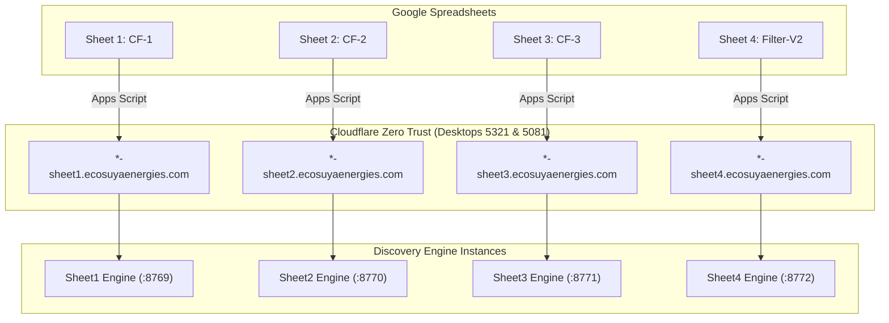

# Discovery Engine Multi-Sheet Fleet

> **Orchestrated 4-Sheet Pipeline with Cloudflare Zero Trust Integration across Desktops 5321 and 5081.**

## Architecture Overview

Discovery Engine is partitioned into 4 dedicated, isolated pipelines corresponding to the 4 production Google Sheets. Each sheet instance runs on its own local port, possesses isolated logging and runtime state, and is controlled via a dedicated Google Apps Script menu.



---

## Fleet Specification

The fleet consists of strictly 3 worker machines:
- **Desktop-5321**: `5321-*.ecosuyaenergies.com` (Production Worker)
- **Desktop-5080**: `5080-*.ecosuyaenergies.com` (Production Worker)
- **Device-Vishnu**: `vishnu-*.ecosuyaenergies.com` (Testing / Development Worker)

| Sheet / Pipeline | Folder | Port | Google Spreadsheet Link & ID | Cloudflare Hostnames (5321, 5080, Vishnu) |
| :--- | :--- | :--- | :--- | :--- |
| **CF-1** | `Sheet1/` | `8769` | [CF-1 Domains DB](https://docs.google.com/spreadsheets/d/1JLp0CQ3S2cVj8ykdYpjHe6OvL-Q7rGTm2KCy7aZArNM/)<br>`1JLp0CQ3S2cVj8ykdYpjHe6OvL-Q7rGTm2KCy7aZArNM` | `https://5321-sheet1.ecosuyaenergies.com`<br>`https://5080-sheet1.ecosuyaenergies.com`<br>`https://vishnu-sheet1.ecosuyaenergies.com` |
| **CF-2** | `Sheet2/` | `8770` | [CF-2 Nandan Domains DB](https://docs.google.com/spreadsheets/d/1OYV70F2r7oBUF7_SemXgQVkAHonDWZDjq_p7ve8Uw_o/)<br>`1OYV70F2r7oBUF7_SemXgQVkAHonDWZDjq_p7ve8Uw_o` | `https://5321-sheet2.ecosuyaenergies.com`<br>`https://5080-sheet2.ecosuyaenergies.com`<br>`https://vishnu-sheet2.ecosuyaenergies.com` |
| **CF-3** | `Sheet3/` | `8771` | [CF-3 Nandan Domains DB](https://docs.google.com/spreadsheets/d/1zQr4NyJpkk0Db7cDaDHvNJQJC9ou8rswq8RxsiGUD2k/)<br>`1zQr4NyJpkk0Db7cDaDHvNJQJC9ou8rswq8RxsiGUD2k` | `https://5321-sheet3.ecosuyaenergies.com`<br>`https://5080-sheet3.ecosuyaenergies.com`<br>`https://vishnu-sheet3.ecosuyaenergies.com` |
| **Filter-V2** | `Sheet4/` | `8772` | [Nandan Filter-V2](https://docs.google.com/spreadsheets/d/1iodRlmHB1PmHy2CORe33VQOBA2MpQYHRDPpJPAYUJ9s/)<br>`1iodRlmHB1PmHy2CORe33VQOBA2MpQYHRDPpJPAYUJ9s` | `https://5321-sheet4.ecosuyaenergies.com`<br>`https://5080-sheet4.ecosuyaenergies.com`<br>`https://vishnu-sheet4.ecosuyaenergies.com` |

---

## Concurrency Limit & Automatic Rerouting Policy

1. **Production Concurrency Cap (Max 2 Sheets per Device)**:
   - At any given time, a production desktop (`Desktop-5321` or `Desktop-5080`) can only run a maximum of **2 sheets concurrently**.
   - If a device is already running 2 sheets, any new run triggered for that device is **automatically rerouted** to the other idle production device.
   - When a reroute occurs, the Google Apps Script UI displays an alert notification and spreadsheet toast (e.g. `⚠️ 5321 is at capacity (2/2 sheets active). Automatically rerouted to 5080.`).

2. **Dedicated Testing Device (Device-Vishnu)**:
   - `Device-Vishnu` is reserved for development and testing.
   - The auto-routing and auto-select algorithms **never dispatch** runs to `Device-Vishnu`.
   - Pipelines only run on `Device-Vishnu` when the user **explicitly selects** `Vishnu-*-Pipeline` in the UI wizard.

---

## Directory Structure

```text
Discovery-Engine/
├── control.sh          # Central fleet manager CLI (start, stop, status, tunnel, logs)
├── .env                # Central environment variables & API keys (gitignored)
├── CHANGELOG.md        # Audit log of changes
├── README.md           # Documentation
├── Sheet1/             # Pipeline for CF-1 (Port 8769)
│   ├── api.py, main.py, config.py, models.py, runner.sh, apps_script.gs, Logs/
├── Sheet2/             # Pipeline for CF-2 (Port 8770)
│   ├── api.py, main.py, config.py, models.py, runner.sh, apps_script.gs, Logs/
├── Sheet3/             # Pipeline for CF-3 (Port 8771)
│   ├── api.py, main.py, config.py, models.py, runner.sh, apps_script.gs, Logs/
├── Sheet4/             # Pipeline for Filter-V2 (Port 8772)
│   ├── api.py, main.py, config.py, models.py, runner.sh, apps_script.gs, Logs/
└── Temp_Test/          # Automated test suite (gitignored)
```

> **Note**: All execution scripts reside strictly within their respective `Sheet1/`..`Sheet4/` subdirectories. Redundant root scripts have been removed.

---

## Cloudflare Zero Trust Setup Guide

For each desktop (`5321`, `5080`, `Device-Vishnu`), configure **4 Public Hostnames** under the desktop's tunnel:

### Ingress Rules per Machine
| Sheet | Public Hostname (5321) | Public Hostname (5080) | Public Hostname (Vishnu) | Local Service URL |
| :--- | :--- | :--- | :--- | :--- |
| **Sheet1** | `5321-sheet1.ecosuyaenergies.com` | `5080-sheet1.ecosuyaenergies.com` | `vishnu-sheet1.ecosuyaenergies.com` | `http://localhost:8769` |
| **Sheet2** | `5321-sheet2.ecosuyaenergies.com` | `5080-sheet2.ecosuyaenergies.com` | `vishnu-sheet2.ecosuyaenergies.com` | `http://localhost:8770` |
| **Sheet3** | `5321-sheet3.ecosuyaenergies.com` | `5080-sheet3.ecosuyaenergies.com` | `vishnu-sheet3.ecosuyaenergies.com` | `http://localhost:8771` |
| **Sheet4** | `5321-sheet4.ecosuyaenergies.com` | `5080-sheet4.ecosuyaenergies.com` | `vishnu-sheet4.ecosuyaenergies.com` | `http://localhost:8772` |

---

## Operating Instructions

### 1. Launch Engines with `control.sh`
Run the fleet manager on the desktop:
```bash
./control.sh
```
- **Option 1**: Start All 4 Sheet Engines (`8769`, `8770`, `8771`, `8772`).
- **Option 5**: View real-time port status and tunnel connection.
- **Option 6**: Install/Reconnect Cloudflare tunnel service.

### 2. Deploy Apps Script to Google Sheets
For each of the 4 spreadsheets:
1. Open the sheet in Google Sheets.
2. Go to **Extensions** > **Apps Script**.
3. Paste the contents of `apps_script.gs` from that sheet's folder:
   - For Sheet 1 (CF-1): use `Sheet1/apps_script.gs`
   - For Sheet 2 (CF-2): use `Sheet2/apps_script.gs`
   - For Sheet 3 (CF-3): use `Sheet3/apps_script.gs`
   - For Sheet 4 (Filter-V2): use `Sheet4/apps_script.gs`
4. Save and reload the Google Sheet. The **`🚀 Tracxn Menu`** will appear with:
   - **▶️ Run Pipeline**: 3-step setup wizard with live status probing on desktops 5321 & 5081.
   - **📊 Check Health**: Modal view displaying health status of desktops 5321 & 5081.
   - **🚦 Check Status**: Re-attach and monitor any ongoing run.
   - **🧹 Clean Sheet & ⚠️ Force Reset**: Utilities.

---

## Verification

Run all test suites:
```bash
python3 -m pytest Temp_Test/
```
