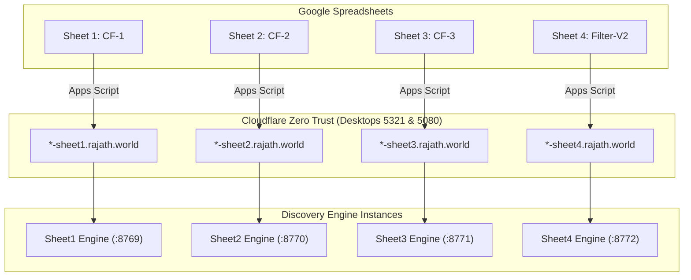

# Discovery Engine Multi-Sheet Fleet

> **Orchestrated 4-Sheet Pipeline with Cloudflare Zero Trust Integration across Desktops 5321 and 5080.**

## Architecture Overview

Discovery Engine is partitioned into 4 dedicated, isolated pipelines corresponding to the 4 production Google Sheets. Each sheet instance runs on its own local port, possesses isolated logging and runtime state, and is controlled via a dedicated Google Apps Script menu or time-driven triggers.



---

## Fleet Specification

The fleet consists of strictly 3 worker machines:
- **Desktop-5321**: `5321-*.rajath.world` (Production Worker)
- **Desktop-5080**: `5080-*.rajath.world` (Production Worker)
- **Device-Vishnu**: `vishnu-*.rajath.world` (Testing / Development Worker)

| Sheet / Pipeline | Folder | Port | Google Spreadsheet Link & ID | Cloudflare Hostnames (5321, 5080, Vishnu) |
| :--- | :--- | :--- | :--- | :--- |
| **CF-1** | `Sheet1/` | `8769` | [CF-1 Python Automation](https://docs.google.com/spreadsheets/d/1Sil5fw0l0rc0aMoydtnn7ZHdDbY5hwl7D9rda7bETkc/)<br>`1Sil5fw0l0rc0aMoydtnn7ZHdDbY5hwl7D9rda7bETkc` | `https://5321-sheet1.rajath.world`<br>`https://5080-sheet1.rajath.world`<br>`https://vishnu-sheet1.rajath.world` |
| **CF-2** | `Sheet2/` | `8770` | [CF-2 Python Automation](https://docs.google.com/spreadsheets/d/1xphjNDv0hHEr8ZXv4PEVDmnEeVrsw_XAUMGaDf8ySUY/)<br>`1xphjNDv0hHEr8ZXv4PEVDmnEeVrsw_XAUMGaDf8ySUY` | `https://5321-sheet2.rajath.world`<br>`https://5080-sheet2.rajath.world`<br>`https://vishnu-sheet2.rajath.world` |
| **CF-3** | `Sheet3/` | `8771` | [CF-3 Python Automation](https://docs.google.com/spreadsheets/d/10pacDW-6EqAdWslv9DTJBrRZDsybMczwMSpmKJebWFc/)<br>`10pacDW-6EqAdWslv9DTJBrRZDsybMczwMSpmKJebWFc` | `https://5321-sheet3.rajath.world`<br>`https://5080-sheet3.rajath.world`<br>`https://vishnu-sheet3.rajath.world` |
| **Filter-V2** | `Sheet4/` | `8772` | [Nandan Filter-V2 Python Automation](https://docs.google.com/spreadsheets/d/14kC-RUMrpJB1Ur4CGpXMh1Te-yv7qBjsINJgM7NqySY/)<br>`14kC-RUMrpJB1Ur4CGpXMh1Te-yv7qBjsINJgM7NqySY` | `https://5321-sheet4.rajath.world`<br>`https://5080-sheet4.rajath.world`<br>`https://vishnu-sheet4.rajath.world` |

---

## Desktop Installation & Setup Guide

Follow this guide to install and run the Discovery Engine fleet on any worker machine (Ubuntu / Debian, Fedora / RHEL, Arch Linux, or macOS).

### 1. Prerequisites
- **Operating System**: Linux (Ubuntu 20.04+, Debian 11+, RHEL/Fedora/Rocky/Alma, Arch) or macOS (Apple Silicon / Intel).
- **Python**: Version 3.10+ installed (`python3 --version`).
- **Permissions**: `sudo` access (required for system packages, cloudflared tunnel service, and systemd/launchd registration).

### 2. Clone the Repository
Open a terminal and clone the repository:
```bash
git clone https://github.com/Viz38/publishing-disc.git Discovery-Engine
cd Discovery-Engine
```

### 3. Environment Configuration (`.env`)
Create or paste your `.env` file into the root of `Discovery-Engine/`:
```bash
# Tracxn & AI Keys
TRACXN_API_TOKEN="your-tracxn-token"
GEMINI_TOKEN="your-gemini-token"
NIM_API_KEYS="nvapi-key1,nvapi-key2,nvapi-key3..."

# Cloudflare Tunnel Authentication Tokens
TUNNEL_TOKEN_5321="eyJhIjoi..."
TUNNEL_TOKEN_5080="eyJhIjoi..."
TUNNEL_TOKEN_VISHNU="eyJhIjoi..."

# Google Sheets Service Account Credentials (raw JSON string or path)
GOOGLE_SERVICE_ACCOUNT_JSON='{"type": "service_account", "project_id": "...", ...}'
GOOGLE_BACKUP_SERVICE_ACCOUNT_JSON='{"type": "service_account", "project_id": "...", ...}'
```

> [!NOTE]
> `control.sh` automatically identifies the machine identity (`Desktop-5321`, `Desktop-5080`, or `Device-Vishnu`) based on hostname and current user, selecting the matching `TUNNEL_TOKEN`.

### 4. Run `control.sh` & Workspace Initialization
Make the central fleet control script executable and start it:
```bash
chmod +x control.sh
./control.sh
```

#### What `control.sh` does automatically:
1. **System Dependency Check**: Inspects your OS and installs missing tools:
   - **Debian / Ubuntu**: Installs `git`, `screen`, `lsof`, `curl`, `ca-certificates`, `build-essential`, `python3-dev`, `python3-venv`.
   - **Fedora / RHEL / CentOS**: Installs `git`, `screen`, `lsof`, `curl`, `ca-certificates`, `gcc`, `gcc-c++`, `make`, `python3-devel`.
   - **Arch Linux**: Installs `git`, `screen`, `lsof`, `curl`, `ca-certificates`, `base-devel`, `python`, `python-pip`.
   - **macOS**: Checks `git` (`xcode-select` / `brew`), `cloudflared`, `screen`, `lsof`, `curl`.
2. **Architecture-Aware Cloudflared**: Automatically downloads and installs the matching `cloudflared` daemon (`x86_64` or `arm64`).

#### Initialize Workspace (Option 1):
From the interactive menu, choose **`1) Init Workspace`**:
- Installs `uv` (ultra-fast package installer) if missing.
- Generates a unified virtual environment (`.venv`).
- Installs all runtime packages via `uv sync` (FastAPI, Uvicorn, Gspread, BeautifulSoup4, Scrapling, Camoufox, Playwright, etc.).
- Pre-downloads Camoufox stealth browser binaries (`camoufox fetch`).
- Validates `.env` and provisions `creds.json` for each sheet pipeline.

### 5. Launch the Engines
Select your desired execution mode from the `control.sh` menu:

- **Option 2: Start Engines (Screen Mode)**:
  - Launches each sheet engine inside dedicated, detached `screen` sessions.
  - Ideal for testing, ad-hoc runs, and development.
- **Option 3: Start Engines (Production Service Mode)**:
  - **Linux**: Creates, enables, and starts native systemd services (`discovery-cf1`, `discovery-cf2`, `discovery-cf3`, `discovery-filterv2`, and `cloudflared.service`).
  - **macOS**: Creates and loads persistent LaunchAgents and LaunchDaemon.
  - Automatically restarts failed processes and persists across machine reboots.

---

## Fleet Management & CLI Operations

The `control.sh` interactive menu provides comprehensive fleet management:

```text
1) Init Workspace (Venv + Dependencies via uv + Credentials)
2) Start Engines (Temp Persistent Background via Screen)
3) Start Engines (Production Service Mode - Ubuntu Systemd / macOS LaunchAgents)
4) Stop & Clean All
5) View Live Logs
6) Check for Updates
7) Clear Logs
8) Configure Credentials
9) Exit
10) Deep Clean Workspace (Venvs + Tunnel + Logs)
```

- **Update Fleet (Option 6)**: Automatically checks all git branches for incoming commits, resets local tracked code cleanly, updates branches, and prompts for restart.
- **Stop All (Option 4)**: Stops all systemd/launchd services, terminates screen sessions, stops Cloudflare tunnels, and frees ports 8769–8772.
- **Live Logs (Option 5)**: Streams live logs from all 4 sheet engines simultaneously.

---

## Concurrency Limit & Automatic Rerouting Policy

1. **Production Concurrency Cap (Max 2 Sheets per Device)**:
   - At any given time, a production desktop (`Desktop-5321` or `Desktop-5080`) can only run a maximum of **2 sheets concurrently**.
   - If a device is already running 2 sheets, any new run triggered for that device is **automatically rerouted** to the other idle production device.
   - When a reroute occurs during manual UI runs, a toast notification alerts the user.

2. **Headless Daily Trigger Resilience**:
   - `triggerDailyDiscoveryRun()` runs with `silent = true` without displaying spreadsheet UI toasts or popups.
   - Time-driven triggers never crash or hang due to UI alert dialogs.

3. **Dedicated Testing Device (Device-Vishnu)**:
   - `Device-Vishnu` is reserved for development and testing.
   - The auto-routing and auto-select algorithms **never dispatch** runs to `Device-Vishnu`.
   - Pipelines only run on `Device-Vishnu` when the user **explicitly selects** `Vishnu-*-Pipeline` in the UI wizard.

---

## Execution Modes & Smart Auto-Resume

The pipeline supports 5 execution modes:
1. **Full Run Mode (`full`)**: End-to-end processing with **smart auto-resume**:
   - If a row already contains a Tech Crawler job ID (Col X), it reuses the job and polls status instead of re-submitting.
   - If a row already has a NIM summary (Col AO / `row[41]`), it reuses the summary directly and proceeds straight to Gemini predictions and Tracxn Write APIs.
2. **Phase 1 Only (`phase1`)**: Tech Crawler Only (generates/polls Tech Crawler jobs, falls back to WaterfallScraper on failure / 3-hour timeout, writes Cols 24–32, and exits).
3. **Phase 2 Only (`phase2`)**: NIM Summary Only (generates summary from scraped markdown, writes Col AO, and skips predictions and write APIs).
4. **Phase 3 Only (`phase3`)**: Gemini Predictions Only (reads Col AO summary, generates IF / validation / feed predictions, and skips write APIs).
5. **Phase 4 Only (`phase4`)**: Tracxn Write API Only (skips extraction and predictions, executes Write APIs, and stamps Col U).

---

## Cloudflare Zero Trust Setup Guide

For each desktop (`5321`, `5080`, `Device-Vishnu`), configure **4 Public Hostnames** under the desktop's tunnel:

### Ingress Rules per Machine
| Sheet | Public Hostname (5321) | Public Hostname (5080) | Public Hostname (Vishnu) | Local Service URL |
| :--- | :--- | :--- | :--- | :--- |
| **Sheet1** | `5321-sheet1.rajath.world` | `5080-sheet1.rajath.world` | `vishnu-sheet1.rajath.world` | `http://localhost:8769` |
| **Sheet2** | `5321-sheet2.rajath.world` | `5080-sheet2.rajath.world` | `vishnu-sheet2.rajath.world` | `http://localhost:8770` |
| **Sheet3** | `5321-sheet3.rajath.world` | `5080-sheet3.rajath.world` | `vishnu-sheet3.rajath.world` | `http://localhost:8771` |
| **Sheet4** | `5321-sheet4.rajath.world` | `5080-sheet4.rajath.world` | `vishnu-sheet4.rajath.world` | `http://localhost:8772` |

---

## Google Apps Script Deployment

For each of the 4 spreadsheets:
1. Open the spreadsheet in Google Sheets.
2. Go to **Extensions** > **Apps Script**.
3. Paste the contents of `apps_script.gs` from that sheet's folder:
   - For Sheet 1 (CF-1): use `Sheet1/apps_script.gs`
   - For Sheet 2 (CF-2): use `Sheet2/apps_script.gs`
   - For Sheet 3 (CF-3): use `Sheet3/apps_script.gs`
   - For Sheet 4 (Filter-V2): use `Sheet4/apps_script.gs`
4. Save the project and reload the Google Sheet. The custom menu **`🚀 Tracxn Menu`** will appear with:
   - **▶️ Run Pipeline**: Wizard supporting worker selection (Auto, 5321, 5080, Vishnu), start row selection, and execution phase mode selection.
   - **📊 Check Health**: Live health modal probing response times across workers.
   - **🚦 Check Status**: Re-attaches to existing running jobs.
   - **🧹 Clean Sheet & ⚠️ Force Reset**: State management and sheet cleanup tools.

### Automated Daily Scheduling:
In Apps Script, navigate to **Triggers** (clock icon) > **Add Trigger**:
- Function to run: `triggerDailyDiscoveryRun`
- Event source: **Time-driven**
- Type: **Day timer** (e.g. 1am to 2am)
This automatically runs Row 3+ with device auto-routing, smart resume, and zero UI crash risks.

---

## Verification & Testing

Run all unit and integration test suites:
```bash
python3 -m unittest discover -s Temp_Test
```
